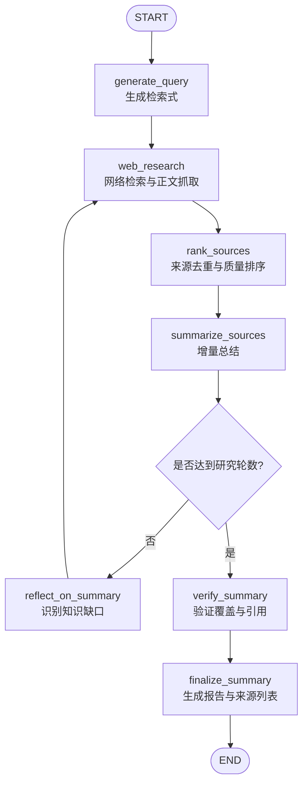

# Local Deep Researcher：本地可靠深度研究 Agent

一个基于 **LangGraph + Ollama** 的本地深度研究智能体。项目围绕“检索—排序—总结—反思—补充检索—验证—生成报告”构建可观察、可迭代的研究工作流，并增加了来源治理、稳定引用和自动评测能力。

> 本项目基于 LangChain 官方开源项目 [local-deep-researcher](https://github.com/langchain-ai/local-deep-researcher) 进行二次开发。基础图结构与本地模型接入来自上游；来源排序、稳定引用、答案验证、路由优化和评测体系是本仓库的主要改造方向。

## 项目解决什么问题

普通“搜索 + 大模型总结”流程容易出现以下问题：

- 搜索接口返回空结果或依赖版本发生变化；
- 搜索结果质量不稳定，官方资料没有得到优先使用；
- 多轮检索后来源重复、引用编号漂移；
- 报告中的引用与实际来源不一致；
- 只看最终文本，无法量化检索与引用质量；
- 无效反思循环增加本地大模型的运行时间。

本项目将这些问题拆成独立节点处理，使每一步都可以在 LangSmith Studio 中观察和调试。

## 核心能力

- **本地推理**：通过 Ollama 运行 Qwen 等开源模型，研究内容无需发送给商业模型 API。
- **状态化工作流**：使用 LangGraph 显式管理查询、来源、摘要、知识缺口和最终报告。
- **多轮反思检索**：模型识别当前摘要的知识缺口，并生成后续检索问题。
- **来源质量治理**：支持偏好域名检索、权威性排序、去重和完整页面抓取。
- **稳定引用**：基于 URL 生成稳定 Source ID，避免检索顺序变化造成引用错位。
- **答案验证**：在最终输出前检查引用、覆盖度和语言要求，并将验证结果写入状态。
- **确定性来源输出**：最终 Sources 由程序根据实际引用过滤，而不是完全依赖模型自由生成。
- **自动评测**：覆盖成功率、延迟、引用有效性、来源利用率、一级来源比例、概念覆盖率、语言一致性和重复来源等指标。

## 工作流架构



| 节点 | 作用 |
| --- | --- |
| `generate_query` | 将用户问题改写为更适合搜索引擎的查询，并优先定位官方或一级来源 |
| `web_research` | 调用搜索服务，规范化 URL，并可抓取完整网页正文 |
| `rank_sources` | 对最新结果去重、评分、排序，再进入摘要阶段 |
| `summarize_sources` | 将新证据合并到已有摘要，保留可追溯的 Source ID |
| `reflect_on_summary` | 找出当前证据缺口，生成下一轮定向查询 |
| `verify_summary` | 检查关键概念、引用格式、语言和证据充分性 |
| `finalize_summary` | 输出最终报告，仅保留正文实际引用的来源 |

## 相比上游的主要改造

1. **修复搜索依赖兼容性**
   将已更名的 `duckduckgo_search` 迁移到 `ddgs`，解决请求无异常但返回空列表的问题。

2. **偏好来源与权威性排序**
   支持 `PREFERRED_SOURCES`，并根据官方文档、官方 GitHub、论文等信号对来源评分，减少营销博客对答案的干扰。

3. **稳定引用标识**
   使用 URL 哈希生成稳定 Source ID，解决不同轮次中编号随排序变化的问题。

4. **显式检索状态**
   增加最新检索结果、来源元数据、验证结果等状态字段，让检索、排序、总结和验证解耦。

5. **验证节点与确定性引用**
   最终报告生成前执行质量检查；来源列表由代码依据正文引用生成，降低“引用了不存在的来源”和未使用来源堆积的问题。

6. **循环与路由优化**
   修复研究轮数边界，并在达到上限时直接进入验证，避免生成不会被使用的后续查询。

7. **可重复评测框架**
   新增问题集、环境变量控制和 JSON 结果保存，能够进行单案例回归与多案例批量测试。

## 技术栈

| 模块 | 技术 |
| --- | --- |
| 工作流编排 | LangGraph |
| 模型调用 | LangChain、Ollama / LM Studio |
| 本地模型 | Qwen3.5 35B A3B（可替换） |
| 网络检索 | DDGS、Tavily、Perplexity、SearXNG |
| 网页处理 | HTTPX、Requests、Markdownify |
| 数据建模 | Pydantic |
| 调试观察 | LangSmith Studio / LangGraph Dev Server |
| 评测 | 自定义 Python Evaluation Harness |

## 快速开始

### 1. 环境要求

- macOS / Linux
- Python 3.11
- [uv](https://docs.astral.sh/uv/)
- [Ollama](https://ollama.com/)

### 2. 安装依赖

```bash
git clone <your-repository-url>
cd local-deep-researcher

uv sync --python 3.11
source .venv/bin/activate
```

### 3. 下载本地模型

```bash
ollama pull qwen3.5:35b-a3b
```

如果 macOS 终端尚未识别 `ollama` 命令，可以使用：

```bash
/Applications/Ollama.app/Contents/Resources/ollama pull qwen3.5:35b-a3b
```

### 4. 配置环境变量

```bash
cp .env.example .env
```

推荐的本地配置：

```dotenv
SEARCH_API=duckduckgo
LLM_PROVIDER=ollama
LOCAL_LLM=qwen3.5:35b-a3b
OLLAMA_BASE_URL=http://localhost:11434
MAX_WEB_RESEARCH_LOOPS=2
FETCH_FULL_PAGE=True
PREFERRED_LANGUAGE=python
```

`PREFERRED_LANGUAGE` 用于优先选择对应的官方文档路径（例如 Python 文档），报告语言仍由用户问题与提示词共同决定。

`.env` 可能包含 API Key，已被 `.gitignore` 排除，请勿提交到 GitHub。

### 5. 启动 LangGraph Studio

```bash
uvx --refresh \
  --from "langgraph-cli[inmem]" \
  --with-editable . \
  --python 3.11 \
  langgraph dev
```

终端会显示本地 API、API Docs 和 Studio UI 地址。开发服务器必须保持运行；关闭终端后 Studio 将无法连接本地图。

## 运行评测

### 单案例回归

```bash
EVAL_CASE=mcp \
EVAL_LIMIT=1 \
EVAL_LOOPS=2 \
EVAL_FETCH_FULL_PAGE=True \
python eval/evaluate.py
```

### 批量评测

```bash
EVAL_LIMIT=10 \
EVAL_LOOPS=2 \
EVAL_FETCH_FULL_PAGE=True \
python eval/evaluate.py
```

评测结果默认写入 `eval/results.json`。仓库仅保留一份经过筛选的基线结果：[`eval/results_10q_2loops_fullpage.json`](eval/results_10q_2loops_fullpage.json)。

### 指标说明

| 指标 | 含义 |
| --- | --- |
| `success_rate` | 工作流是否无异常完成 |
| `average_latency_seconds` | 单个研究任务平均端到端耗时 |
| `citation_validity` | 正文引用 ID 是否能在来源表中找到 |
| `source_utilization` | 收集到的来源有多少真正被正文使用 |
| `primary_source_ratio` | 使用来源中官方文档、论文、官方仓库等一级来源占比 |
| `concept_coverage` | 预设关键概念在报告中的覆盖比例 |
| `language_consistency` | 输出语言是否符合案例要求 |
| `duplicate_source_free` | 最终来源列表是否不存在重复 Source ID |

## 当前实验结果

在 `10` 个问题、`2` 轮检索、开启完整页面抓取的基线实验中：

- 成功率：**10/10（100%）**
- 平均端到端延迟：**308.1 秒/题**
- 引用有效性：**100%**
- 来源利用率：**100%**
- 一级来源比例：**100%**

路由优化的单案例实验中，MCP 案例耗时由约 **328.73 秒** 降至 **227.88 秒**，初步下降约 **30.7%**。该结果来自单次本地运行，只能说明优化方向有效，不能替代多次重复实验。

最新 vLLM 回归实验的语言一致性与来源去重均通过，但概念覆盖率为 **50%**。这说明“引用结构正确”不等于“内容完整”，也是加入概念覆盖率指标的原因。

> 注意：引用有效性 100% 表示引用结构和来源映射正确，并不代表所有自然语言结论都已经得到形式化事实验证。

## 项目结构

```text
local-deep-researcher/
├── src/ollama_deep_researcher/
│   ├── graph.py          # LangGraph 节点、边与路由
│   ├── state.py          # 工作流状态定义
│   ├── configuration.py  # 可配置参数
│   ├── prompts.py        # 查询、总结、反思与验证提示词
│   ├── utils.py          # 搜索、抓取、来源格式化与排序
│   └── lmstudio.py       # LM Studio 兼容接口
├── eval/
│   ├── evaluate.py       # 自动评测入口
│   ├── questions.json    # 评测问题与概念要求
│   └── results_10q_2loops_fullpage.json
├── .env.example          # 安全配置模板
├── langgraph.json        # LangGraph 应用入口
└── pyproject.toml        # 项目依赖
```

## 已知限制

- DDGS 是免费搜索后端，没有稳定性和速率 SLA；生产环境可替换为 Tavily、Perplexity 或自建 SearXNG。
- 当前使用内存版 LangGraph Dev Server，重启后线程状态不会长期保存；生产环境应接入持久化 Checkpointer。
- 来源权威性排序目前以规则为主，对不同领域需要单独校准。
- 验证节点基于 LLM 和规则，不等同于严格的事实证明系统。
- 35B 本地模型在 CPU/GPU 共享内存设备上的延迟较高，可通过更小模型、缓存、并行抓取和减少上下文优化。
- 概念覆盖率仍受检索召回和提示词影响，需要继续扩充评测集并进行多次重复实验。

## 后续方向

- 接入 SQLite / PostgreSQL Checkpointer，实现跨重启恢复；
- 增加检索缓存、超时、重试和并发抓取；
- 使用 LLM-as-a-Judge 与人工标注共同评估事实支持度；
- 为不同任务动态选择模型、检索后端和研究轮数；
- 增加 Docker 化部署、CI 测试和可视化评测报告。

## 致谢与许可证

感谢 [LangChain](https://github.com/langchain-ai) 提供原始项目和 LangGraph 生态。本项目沿用上游仓库的 [MIT License](LICENSE)。
